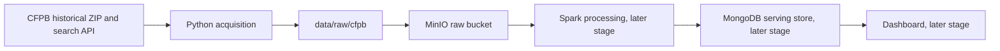

# Banking Complaints Data Platform

Data platform for the CFPB Consumer Complaint Database. The acquisition layer keeps the full historical source and incremental API responses in raw form; subject filtering and analytics belong in later processing stages.

## Architecture



Historical files are downloaded as a stream and extracted/count-checked with streaming I/O. Incremental API results are kept as page-level JSON files with run manifests and a high-water mark. Both paths upload to the existing S3-compatible MinIO service.

## Quick start (Windows CMD)

```bat
py -3.10 -m venv .venv
.venv\Scripts\activate
python -m pip install -r requirements.txt
copy .env.example .env
```

Edit `.env` with local credentials before starting Docker. Existing `.env` files are private and must not be committed.

```bat
docker compose up -d minio mongodb
curl http://localhost:9000/minio/health/live
```

## Acquisition commands

Historical ingestion for a new date partition (the archive is about 366 MB; do not repeat it for routine testing):

```bat
python ingestion/full_load.py --ingest-date 2026-11-20
python ingestion/extract_manifest.py --ingest-date 2026-11-20
python ingestion/upload_raw.py --ingest-date 2026-11-20
```

The supplied copy already has a complete `2026-11-12` local partition; upload it without downloading or extracting again using `python ingestion/upload_raw.py --ingest-date 2026-11-12`. Uploads are checksum-aware: identical objects are skipped; a legacy or conflicting object without matching SHA-256 metadata stops unless `--force` is explicit and replacement is intended.

Incremental API ingestion (first run requires a starting date):

```bat
python ingestion/run_incremental.py --start-date 2026-11-19 --end-date 2026-11-19 --overlap-days 0
```

Subsequent runs read `data/raw/cfpb/api/high_water_mark.json` and start from the last successfully queried date by default. The checkpoint also records when the last API call succeeded and is updated only after the raw run uploads. The CFPB filter works by calendar date, so the saved boundary date is included and may be fetched again. Use `--overlap-days 7` when you want a wider late-arrival check; that intentionally repeats more raw records. Spark should deduplicate by complaint ID in curated data.

Run offline acquisition tests with `python -m unittest discover -s tests -v` (or `python -m pytest`).

See [the acquisition implementation guide](docs/acquisition/ACQUISITION_IMPLEMENTATION_GUIDE.md) for implementation details and [the acceptance test runbook](docs/acquisition/PERSON_1_ACCEPTANCE_TEST_RUNBOOK.md) for the plain-language handoff, current checkpoint, manual run steps and verified results.
