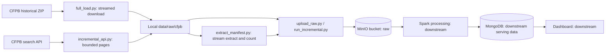

# Acquisition and Raw Storage Implementation Guide

## A. Introduction

This guide describes the CFPB acquisition component for the Banking Complaints Data Platform. It supports two different source shapes:

- **Historical full load:** the official complete CSV ZIP is streamed to disk, extracted, counted, checksummed and described by a manifest. Acquisition keeps every product. Student-loan selection belongs in the downstream Spark stage.
- **Incremental collection:** date-bounded pages from the CFPB search API are preserved as original JSON response bodies. Each run has a manifest and a persisted high-water mark JSON checkpoint that records the last successful call date/time; its default overlap is zero days, with optional overlap for late arrivals.

Local raw files are uploaded to the existing S3-compatible MinIO service in the `raw` bucket. MongoDB, Spark and the dashboard are downstream services; this component does not create collections, process records or build analytics.

## B. Architecture



The historical archive is a full snapshot. API pages are incremental observations over a bounded date window. Keeping them separate makes the source and run boundaries visible. The raw API collector preserves duplicate observations; downstream curation should deduplicate by complaint ID, retaining the record from the latest successfully completed API run (`completed_at_utc`) and recording conflicts. The API collector intentionally does not filter by product.

## C. Repository structure

| Path | Purpose |
|---|---|
| `ingestion/full_load.py` | Streams and hashes the historical ZIP; records HTTP/retry metadata. |
| `ingestion/extract_manifest.py` | Extracts the CSV in chunks, counts CSV records without pandas, and writes the historical manifest. |
| `ingestion/incremental_api.py` | Fetches paginated CFPB JSON, stores immutable run responses/manifests, and updates the local high-water mark after a complete local run. |
| `ingestion/upload_raw.py` | Creates/verifies the bucket and uploads historical or API files with size and checksum metadata checks. |
| `ingestion/run_incremental.py` | Scheduled-operation entry point: collects, uploads the run, then advances and publishes the high-water mark. |
| `tests/test_acquisition.py` | Offline tests using temporary archives, fake HTTP/S3 responses and a small API fixture. |
| `tests/fixtures/sample_api_response.json` | Synthetic one-record API response for development and integration. |
| `docs/acquisition/ACQUISITION_IMPLEMENTATION_GUIDE.md` | This guide. |
| `docker-compose.yml` | Existing MinIO and MongoDB services. The existing MinIO community fork has been retained. |
| `.env.example` | Safe placeholders for a developer's local `.env`. |
| `.gitignore` | Excludes local environment files, virtualenv, datasets and temporary files. |
| `requirements.txt` | Exact pins for runtime and test dependencies. |
| `README.md` | Short project and acquisition entry point. |
| `data/raw/cfpb/` | Local raw storage; ignored by Git. Do not commit the archive or extracted CSV. |

## D. Technologies

- **Python 3.10:** scripts, CLI arguments, CSV and ZIP streaming, manifests and tests.
- **Requests:** CFPB HTTPS requests with streaming, timeouts, status validation and bounded retries.
- **boto3:** S3-compatible MinIO bucket/object operations and multipart upload.
- **MinIO:** S3-compatible raw object storage. The Compose file uses the existing `pgsty/silo:RELEASE.2026-10-26T00-00-00Z` image and must not be silently replaced.
- **Docker Compose:** starts the already configured MinIO and MongoDB services.
- **pytest / unittest:** offline automated tests. The cases use `unittest`, so they can run without installing pytest; both are included in the pinned development setup.
- **python-dotenv:** loads local `.env` values for boto3 configuration.

## E. Environment setup from a fresh clone

The repository URL below is supplied by the project brief. Run these commands in a new working directory, not in a directory containing another project.

### Windows CMD

```bat
git clone https://github.com/dimitriKhnaisser/Banking-Complaints-Data-Platform---Big-Data.git Banking-Complaints-Data-Platform
cd Banking-Complaints-Data-Platform
py -3.10 -m venv .venv
.venv\Scripts\activate
python -m pip install -r requirements.txt
copy .env.example .env
notepad .env
```

Replace every credential placeholder in `.env` with local values. Keep the MinIO and MongoDB credentials separate if desired. Never paste a real `.env` into source control or a public issue.

Start only the existing services:

```bat
docker compose up -d minio mongodb
docker compose ps
curl http://localhost:9000/minio/health/live
```

Open the MinIO console at `http://localhost:9001` and sign in with the local MinIO credentials. `upload_raw.py` creates the configured `raw` bucket on the first upload if it does not exist. The local endpoint defaults to `http://localhost:9000`.

### Git Bash

```bash
git clone https://github.com/dimitriKhnaisser/Banking-Complaints-Data-Platform---Big-Data.git Banking-Complaints-Data-Platform
cd Banking-Complaints-Data-Platform
py -3.10 -m venv .venv
source .venv/Scripts/activate
python -m pip install -r requirements.txt
cp .env.example .env
notepad.exe .env
docker compose up -d minio mongodb
docker compose ps
curl http://localhost:9000/minio/health/live
```

The MinIO console is `http://localhost:9001`. For the application to reach a container port from Windows, keep `S3_ENDPOINT=http://localhost:9000`.

## F. Historical ingestion

### Safe sequence

The ZIP is approximately 366 MB and the extracted CSV is several GB. Do not repeat a full download to test code. In the supplied working copy, a 2026-11-12 ZIP, CSV and historical manifest already exist. The download script detects an existing archive and skips it unless `--force` is given. Extraction similarly refuses to replace an existing CSV or manifest without `--force`.

For a genuinely new date partition, run:

```bat
python ingestion/full_load.py --ingest-date 2026-11-20
python ingestion/extract_manifest.py --ingest-date 2026-11-20
python ingestion/upload_raw.py --ingest-date 2026-11-20
```

Use the actual current UTC date for a new partition. If a complete local partition already exists, upload it directly rather than redownloading or re-extracting:

```bat
python ingestion/upload_raw.py --ingest-date 2026-11-12
```

To intentionally replace a local archive, supply `--force` to `full_load.py`; its `.part` file replaces the prior ZIP only after a successful non-empty transfer. To intentionally regenerate extracted outputs, supply `--force` to `extract_manifest.py`. These are explicit replacement operations.

### Download and extraction details

`full_load.py` requests the official `https://files.consumerfinance.gov/ccdb/complaints.csv.zip` using streaming mode and 1 MiB chunks. It uses connect/read timeouts, at most three attempts, and exponential backoff for connection/timeouts and temporary HTTP statuses (408, 425, 429 and 5xx). It writes `complaints.csv.zip.part`, computes SHA-256 and byte count while streaming, and atomically replaces the final file only after success. Failed partial transfers are removed. `download_metadata.json` records URL, HTTP status, attempt/retry counts, UTC download time, size and SHA-256.

`extract_manifest.py` reads the ZIP entry in 1 MiB chunks to a temporary CSV. Python's `csv` reader counts logical records, so quoted embedded newlines do not inflate the count. It records the header columns and file sizes/checksums. No pandas DataFrame is created. `--ingest-date` selects the partition; absent that argument, the current UTC date is used. For an archive created before download sidecar metadata existed, download time/status/retry metadata remain null rather than being inferred from the ZIP filesystem timestamp.

### Historical manifest fields

`run_id`, `source_url`, `ingest_date`, `downloaded_at_utc`, `http_status`, `download_attempt_count`, `download_retry_count`, `manifest_created_at_utc`, ZIP filename/size/SHA-256, CSV filename/size/SHA-256, `record_count`, `columns`, and `outcome`.

The previous local manifest for 2026-11-12 records 19,112,942 records, a 366,121,838-byte ZIP and a 5,797,256,221-byte CSV. Its historical download timestamp was generated by the earlier script; new runs use the download sidecar timestamp.

## G. Incremental API ingestion

The collector uses the CFPB search API at `https://www.consumerfinance.gov/data-research/consumer-complaints/search/api/v1/`. Date bounds use `date_received_min` inclusive and `date_received_max` exclusive. The script converts the requested inclusive `--end-date` to the next day for the API. It requests a bounded number of results per page and follows the API's `_meta.break_points` cursor when present. If the API omits that cursor map, it uses the last hit's `sort` values with `search_after`, plus the next `page`/`frm` offset. It saves each response body as `response_00001.json`, etc., without reshaping/filtering records. Each page manifest entry includes non-secret request parameters and pagination cursor/offset alongside HTTP status, attempts, response size, checksum and record count. A successful zero-hit response is saved with a success manifest and count zero. Review the [CFPB API documentation](https://cfpb.github.io/api/ccdb/api.html) and [release notes](https://cfpb.github.io/api/ccdb/release-notes.html) during integration if parameters, fields or export behavior change.

First local-only run:

```bat
python ingestion/incremental_api.py --start-date 2026-11-19 --end-date 2026-11-19 --overlap-days 0 --page-size 1000
```

For collection, upload and watermark publication together (requires reachable MinIO and configured credentials):

```bat
python ingestion/run_incremental.py --start-date 2026-11-19 --end-date 2026-11-19 --overlap-days 0 --page-size 1000
```

After a first successful run, omit `--start-date`; the runner starts from the saved high-water date (inclusive) minus any optional overlap and ends at today UTC by default:

```bat
python ingestion/run_incremental.py --overlap-days 0 --page-size 1000
```

The collector retries temporary request failures at most three times. It writes each run under a unique `run_id`, saves a manifest only after all pages finish, and refuses to advance the watermark if pagination is incomplete or the API total changes during paging. The run uploader writes the complete raw snapshot before advancing/publishing the watermark. If upload fails, the local run remains available for manual re-upload; its high-water mark is not advanced.

The mark is the latest fully collected inclusive `date_received` date, not a claim that the CFPB never changes older records. Each scheduled run starts from the saved date by default; `--overlap-days 7` re-requests a wider seven-day window to catch late arrivals. The API filters by calendar date, not exact call time, so the saved boundary date can appear again. This deliberately creates overlapping raw observations when overlap is enabled; downstream curation should deduplicate by `complaint_id`, retain the version from the latest successful run by `completed_at_utc`, and report conflicting versions. Revisions to records older than the overlap may require a historical reconciliation run. The collector does not filter student loans.

The uploader skips an existing raw-run key only when its stored size and SHA-256 metadata match the local file. Older MinIO run objects created before this checksum metadata was added are treated as unverified conflicts. The normal workflow stops on such a conflict; use `--force` only after confirming that replacing the exact run object with the reviewed local content is intended. The single `high_water_mark.json` object is intentionally updated after each complete run upload; it is mutable run state, while the run folders remain immutable.

The API offset limit is 100,000. If a date range exceeds that limit, the run fails without advancing its mark and tells the operator to split the date window. Keep windows bounded. During the demonstration period, configure Windows Task Scheduler to run every 12 or 24 hours: set Program to the repository's `.venv\Scripts\python.exe`, arguments to `ingestion\run_incremental.py --overlap-days 0`, and “Start in” to the repository root. A manual trigger of the same collector is acceptable in the live demonstration. Configure the task under the same Windows account that can access Docker and the local `.env`.

## H. Data and object structure

Local historical layout:

```text
data/raw/cfpb/full_load/ingest_date=YYYY-MM-DD/
  complaints.csv.zip
  download_metadata.json       # new downloads
  complaints.csv
  manifest.json
```

Local API layout:

```text
data/raw/cfpb/api/
  high_water_mark.json
  ingest_date=YYYY-MM-DD/run_id=UTC_TIMESTAMP-UUID/
    response_00001.json
    response_00002.json
    manifest.json
```

MinIO bucket and object keys:

```text
raw/cfpb/full_load/ingest_date=YYYY-MM-DD/{complaints.csv.zip,complaints.csv,manifest.json,download_metadata.json}
raw/cfpb/api/ingest_date=YYYY-MM-DD/run_id=RUN_ID/{response_00001.json,...,manifest.json}
raw/cfpb/api/high_water_mark.json
```

The historical uploader includes `download_metadata.json` when available. New objects carry SHA-256 user metadata and are size/checksum-metadata verified after upload. An exact matching object is skipped on rerun. An existing object without a matching checksum is treated as a conflict; `upload_raw.py --force` explicitly allows replacement. Each API page manifest entry has the response filename, non-secret request parameters including pagination state, HTTP status, attempt/retry count, byte size, SHA-256 and record count. The API run manifest records ID, source URL, requested inclusive bounds, API exclusive upper bound, UTC timestamps, page size/count, total collected count, API total, page inventory and outcome.

Example historical manifest (values are synthetic):

```json
{
  "run_id": "00000000-0000-4000-8000-000000000001",
  "source_url": "https://files.consumerfinance.gov/ccdb/complaints.csv.zip",
  "ingest_date": "2026-11-20",
  "downloaded_at_utc": "2026-11-20T10:00:00+00:00",
  "http_status": 200,
  "download_attempt_count": 1,
  "download_retry_count": 0,
  "zip_size_bytes": 1234,
  "zip_sha256": "synthetic-checksum",
  "csv_size_bytes": 4321,
  "csv_sha256": "synthetic-checksum",
  "record_count": 2,
  "columns": ["Date received", "Product", "Complaint ID"],
  "outcome": "success"
}
```

Example API body is also synthetic and contains no consumer information; the same structure is stored as `tests/fixtures/sample_api_response.json`:

```json
{"hits":{"total":{"value":1},"hits":[{"_source":{"complaint_id":9000000001,"date_received":"2026-11-20","product":"Student loan","sub_product":"Federal student loan servicing","issue":"Dealing with your lender or servicer","company":"Example Servicer","state":"CA","submitted_via":"Web"}}]},"_meta":{"break_points":{}}}
```

Example API run-manifest and high-water state (synthetic):

```json
{
  "run_id": "20261120T100000Z-1111aaaa",
  "source_url": "https://www.consumerfinance.gov/data-research/consumer-complaints/search/api/v1/",
  "ingest_type": "incremental_api",
  "ingest_date": "2026-11-20",
  "requested_date_min": "2026-11-20",
  "requested_date_max_inclusive": "2026-11-20",
  "api_date_received_max_exclusive": "2026-11-21",
  "started_at_utc": "2026-11-20T10:00:00+00:00",
  "completed_at_utc": "2026-11-20T10:00:03+00:00",
  "page_size": 1000,
  "page_count": 1,
  "record_count": 1,
  "api_total": 1,
  "pages": [{
    "file": "response_00001.json",
    "request_params": {"date_received_min": "2026-11-20", "date_received_max": "2026-11-21", "size": 1000, "frm": 0, "page": 1},
    "http_status": 200,
    "attempt_count": 1,
    "retry_count": 0,
    "size_bytes": 420,
    "sha256": "synthetic-checksum",
    "record_count": 1
  }],
  "outcome": "success"
}
```

```json
{
  "high_water_mark": "2026-11-20",
  "last_api_call_date_utc": "2026-11-20",
  "last_api_call_at_utc": "2026-11-20T10:00:00+00:00",
  "last_requested_date_min": "2026-11-20",
  "last_requested_date_max_inclusive": "2026-11-20",
  "updated_at_utc": "2026-11-20T10:00:03+00:00",
  "last_successful_run_id": "20261120T100000Z-1111aaaa",
  "last_successful_run_manifest": "data/raw/cfpb/api/ingest_date=2026-11-20/run_id=20261120T100000Z-1111aaaa/manifest.json",
  "overlap_days": 0
}
```

## I. Testing

Offline tests are in `tests/test_acquisition.py`. They cover streaming call behavior on a tiny response, historical/API retries after temporary HTTP errors and an API timeout, preservation of an existing archive, streamed ZIP extraction and CSV record counting, failure-safe forced extraction, two-page API cursor handling/raw response retention/high-water advancement, successful empty responses, replay into distinct raw runs, refusing to advance on a missing cursor, preserving malformed JSON before parsing fails, parsing the sample API fixture, skipping an identical mocked MinIO object, and refusing to overwrite an unverified existing object.

Run without contacting CFPB or MinIO:

```bat
.venv\Scripts\python.exe -m unittest discover -s tests -v
```

Or, after installing the requirements in a fresh environment:

```bat
python -m pytest -q
```

No live CFPB request, full historical ingestion, MinIO upload or Docker service was run during this implementation. A deliberately bad pagination response is included in the acquisition tests: it returns one hit while claiming two and omits the next-page cursor. The collector detects this incomplete response, fails the run and leaves the high-water mark unchanged. During development, the timeout test initially failed because the fake session returned a timeout object instead of raising it; the fake response harness was corrected to raise configured exceptions, and the full suite then passed. The brief's separate bad-record examples (invalid date or duplicate complaint ID) belong to Spark transformation/quality tests and remain for that role to implement.

## J. Docker operations

The Compose file retains the current MinIO fork and MongoDB 7 service, named volumes `minio_data` and `mongo_data`, and existing ports. Only these already configured services should be started for acquisition:

```bat
docker compose up -d minio mongodb
docker compose ps
docker compose logs --tail 100 minio
docker compose logs --tail 100 mongodb
docker compose restart minio
docker compose restart mongodb
curl http://localhost:9000/minio/health/live
docker compose stop minio mongodb
docker compose down
```

`docker compose down` removes containers/network but leaves named volumes. Never use `docker compose down -v` as a routine command: `-v` deletes persistent volumes and can permanently remove MinIO and MongoDB data. The existing Compose file has no explicit memory limits. This work did not change Docker limits or run the services. Docker Desktop memory allocation is also a user-managed setting and was not changed.

To inspect stored objects, use the MinIO web console at `http://localhost:9001` (credentials are the local values in `.env`) or an already-installed S3 client configured for endpoint `http://localhost:9000`, region `us-east-1`, path-style addressing and bucket `raw`. Example with AWS CLI if it is installed:

```bat
aws --endpoint-url http://localhost:9000 s3 ls s3://raw/cfpb/ --recursive
```

If you cannot connect, first check `docker compose ps`, MinIO logs and the health URL. Do not reset volumes to troubleshoot connectivity.

## K. Configuration and security

`.env.example` has placeholders only; copy it to `.env` and replace placeholders locally. The uploader reads `MINIO_ROOT_USER`, `MINIO_ROOT_PASSWORD`, `S3_ENDPOINT` and `S3_BUCKET`; Compose also reads MongoDB credentials. `.gitignore` excludes `.env`, environment variants except the safe `.env.example`, `data/`, ZIP/CSV files, `.venv`, bytecode and `.part` files. Do not add real credentials, downloaded data or generated secrets to Git. If credentials were exposed, rotate them in the service configuration using the team's approved procedure; this component does not alter credentials.

## L. RAM and performance

The historical ZIP download and CSV extraction use 1 MiB blocks. Record counting uses the streaming standard-library CSV reader. The API defaults to 1,000 records per page and keeps only one page response in memory. No pandas, Spark or Hadoop process is launched. The S3 multipart chunk size remains 64 MiB and concurrency is capped at two transfers to bound memory use. The historical CSV is several GB on disk, but is never read into a complete in-memory object.

No explicit Docker memory ceiling was configured because the existing deployment's working requirements and machine allocation were not measurable without starting the services. The project brief suggested 512 MB for MinIO and 1 GB for MongoDB as possible ceilings; treat them as suggestions requiring verification before applying. A Docker Desktop allocation around 3 GB maximum was also a project suggestion, not a setting changed here.

## M. Troubleshooting

| Symptom | Check or recovery |
|---|---|
| MinIO connection refused | Start `minio`, check port 9000 and the health URL; leave volumes intact. |
| Wrong S3 endpoint | For host-run Python use `http://localhost:9000`; container-to-container networking requires a different service hostname and should be configured deliberately. |
| Authentication/access denied | Confirm local `.env` credentials match the running service. The uploader only creates a bucket on a genuine not-found response; other errors are raised. Never print credentials. |
| Existing historical partition | Default behavior preserves it. Upload it directly or select another date; only use `--force` when replacement is intended. |
| Incomplete `.part` file | The scripts clean their own temporary files on ordinary failures. If an old abandoned `.part` exists, inspect it and remove only that specific temporary file after confirming no process is using it. |
| HTTP 4xx | Non-temporary errors stop promptly; check the URL/parameters. 408/425/429/5xx and network timeouts receive up to three attempts. |
| API page/cursor failure | The run does not advance the mark. Keep its diagnostic pages, narrow the date range, and rerun. |
| High-water mark not advancing | Confirm all pages completed; the scheduled runner also requires the MinIO run upload to succeed. Check run manifest and errors. |
| Docker memory pressure | Stop unneeded services without deleting volumes; inspect Docker Desktop allocation. No resource limit was applied in this work. |
| CSV field-size error | Extraction sets `csv.field_size_limit(2**31 - 1)` before parsing. Check Python version and CSV encoding if it recurs. |
| Missing credentials | Copy `.env.example` to `.env`, fill local values and retry. The `.env` file is intentionally not displayed in logs or documentation. |

## N. Integration instructions

The Spark developer can read the full historical CSV from the `raw` bucket key `cfpb/full_load/ingest_date=.../complaints.csv`, and can inspect the matching manifest for row count, columns, source URL, size and checksums. API observations live under `cfpb/api/ingest_date=.../run_id=.../response_*.json`; the per-run manifest lists all pages, request parameters and counts/checksums. The raw archive is retained as well. The `high_water_mark.json` is collection state, not a transformed dataset.

The historical and API collections contain all products; apply the project's student-loan condition in Spark. Incremental pages may overlap when `--overlap-days` is positive, so deduplicate on `complaint_id`, while accounting for CFPB updates to existing complaints. MongoDB and dashboard developers should consume outputs from the agreed Spark/database interfaces; this acquisition work does not prescribe collections or dashboard queries.

## O. Requirements checklist and evidence

The official project brief was reviewed in full. The table below maps the acquisition-relevant requirements to implementation and evidence. Processing, MongoDB, analysis and dashboard requirements belong to other team roles.

| Official brief requirement | Implementation | Evidence / status |
|---|---|---|
| Section 5: scheduled collection, MinIO raw storage, manifests/checksums/counts and operations | Collectors, uploader, existing Compose, README and guide | Interfaces documented; existing MinIO was reached through its S3 API and new raw API run objects were uploaded. Docker services were not started. Existing MinIO fork still needs lecturer approval. |
| Section 6.1: keep full archive and extracted copy by date, manifest/provenance/count, empty-environment reproduction, API response path | `full_load.py`, `extract_manifest.py`, `upload_raw.py`, `.env.example`, README | Streaming/checksum/count/date arguments implemented; API objects use `raw/cfpb/api/.../response_<page>`. Fresh-clone reproduction is documented but not run. |
| Section 6.2: scheduled bounded windows, pagination/retries, raw-before-processing, empty success, run logs, high-water/overlap/replay | `incremental_api.py`, `run_incremental.py`, tests | 19 offline tests cover checkpoint-based start dates and refusing to advance after an upload failure, page cursor fallback, timeout/retry, empty response, replay into a distinct run, incomplete pagination, malformed raw preservation and oversize-window protection. Two live CFPB runs for 2026-11-19 each returned six pages / 5,046 records. Two later live runs for 2026-11-20 returned successful empty results. The latest manifest and checkpoint were verified in MinIO; the latest run is `20261120T164036Z-1b10f06f`. Curated-count replay remains for Spark. |
| Section 6.5: Compose instructions, secret handling, example config, pinned dependencies, small development sample | `README.md`, this guide, `.env.example`, `.gitignore`, `requirements.txt`, `tests/fixtures/` | Exact dependency pins and a synthetic API fixture are supplied. Compose limits are not set; services were not started. |
| Section 10: collector known window, pagination, timeout/HTTP failure, empty result and repeated request | `tests/test_acquisition.py` | Offline tests cover these collector cases and mocked object replay. Invalid-date/duplicate-ID checks belong to Spark and remain unimplemented here. |
| Section 11: source repository, setup/operating guide, raw artefacts and demo evidence | README, this guide, manifests and fixture | Acquisition docs/sample supplied. Two live paginated run manifests and MinIO upload verification are recorded in the acceptance runbook. |
| Section 12: acquisition and raw storage (15% criterion) | Acquisition scripts, tests and demo evidence above | Nineteen offline tests pass. Two live paginated CFPB runs for November 19 and two successful empty-result runs for November 20 were uploaded. The latest checkpoint and manifest were verified in MinIO. Fresh-environment reproduction and the final team demonstration remain to be completed. |
| Section 13: required repository structure and traceability | Existing directories, README and guide | Required top-level directories exist; acquisition handoff is documented. |
| Lecturer approval for MinIO community fork | Existing Compose image retained | Approval still required; no storage technology switch made. |

## P. Demonstration guide

Use an existing verified historical partition if available. Demonstrate its manifest and ZIP/CSV object sizes in the MinIO console; do not download the 366 MB archive again solely for a demo. For the incremental portion, first run the offline tests, then demonstrate a small live date window with explicit dates, inspect its `run_id`, raw pages and manifest locally/under MinIO, inspect `high_water_mark.json`, and rerun without `--start-date` to show overlap. The run ID keeps each replay in a separate path. Do not claim live API pagination unless more than one page was returned in that demonstration. Finish with the offline tests to show repeatable mocked coverage.

Suggested sequence:

1. Show the existing historical `manifest.json` and the original ZIP/CSV partition.
2. Show `raw/cfpb/full_load/...` objects in MinIO.
3. Run `python -m unittest discover -s tests -v`.
4. Run one explicit bounded `run_incremental.py` date window.
5. Show its run ID, page count and manifest in MinIO.
6. Show the high-water mark; run the command without a start date to demonstrate seven-day overlap.
7. Confirm each run uses a unique folder and that no existing partition was replaced.

## Q. Handover

Ready interfaces for teammates are: full historical CSV + archive + manifest in `raw/cfpb/full_load/...`; page-level raw API JSON + manifest in `raw/cfpb/api/...`; and `high_water_mark.json` for scheduled collection state. Use the `raw` bucket, `us-east-1` region and path-style endpoint configuration. Preserve raw partitions, read manifests before processing, do not assume the source is pre-filtered to student loans, and deduplicate incremental overlap downstream using complaint IDs, retaining the latest successful run version by completion time and reporting conflicts. The existing MinIO image substitution remains subject to lecturer approval.

## Verification limits for this copy

The local historical data and `.env` existed before editing and were not modified; the historical ZIP/CSV were not reread or rehashed. Two bounded live CFPB runs and MinIO uploads were performed and recorded in the acceptance runbook. No Docker command, MongoDB operation, full historical ingestion, commit or push was performed. Pytest is pinned for fresh setup but is not installed in the existing venv, so verification used `unittest`. The invalid-date/duplicate-ID data-quality demonstration is a Spark responsibility and was not implemented in the acquisition component.
